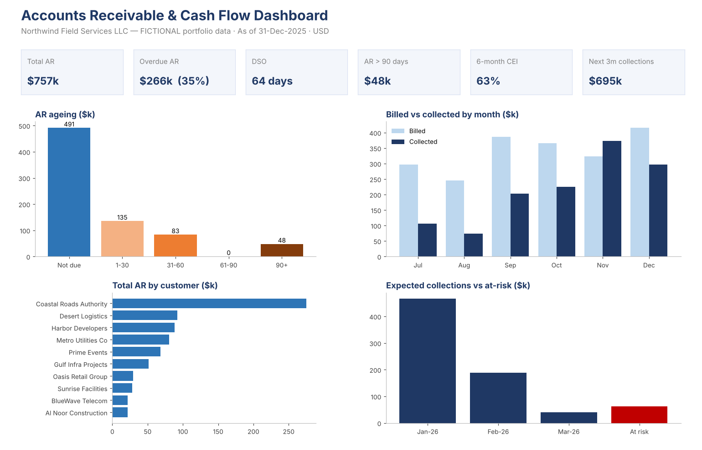

# Project 02: Accounts Receivable & Cash Flow Dashboard

> **Portfolio project using fictional data.** Northwind Field Services LLC is an invented company. The figures do not come from any real employer or client, and they are not employment results.

## Business question
How healthy are the company's receivables, which customers need collection action, and how much cash can it expect to collect over the next three months?

## Dataset (fictional)
- 90 invoices issued July to December 2025 to 10 customers in construction, infrastructure, utilities, logistics, telecom, real estate, facilities management, government, events and retail
- Each customer has its own payment terms (15 to 90 days) and credit limit
- Payment dates and partial payments are simulated to reflect different payment behaviour by customer

## What the workbook does
| Sheet | Purpose |
|---|---|
| **Assumptions** | Report date, DSO lookback period, collection probabilities by ageing bucket. Yellow cells are editable inputs |
| **Customers** | Customer master: segment, payment terms, credit limit |
| **Invoices** | Invoice register. Due date, outstanding balance, days past due and ageing bucket are calculated with formulas |
| **AR_Aging** | Ageing by customer (Not due / 1-30 / 31-60 / 61-90 / 90+) using `SUMIFS`, plus a credit-limit check |
| **Collections_KPI** | Monthly billed vs collected, roll-forward of opening to closing AR, Collection Effectiveness Index (CEI), DSO |
| **Cash_Forecast** | Expected collections for Jan to Mar 2026, weighted by bucket-level collection probability, with the at-risk balance |
| **Dashboard** | KPI tiles and charts |

All results are formula-driven, so changing the report date or an assumption updates the whole workbook.

## Key results (as of 31-Dec-2025)
| KPI | Result |
|---|---|
| Total AR | $757k |
| Overdue AR | $266k (35% of AR) |
| DSO (90-day basis) | 64 days |
| AR over 90 days | $48k |
| 6-month CEI (simplified) | 63% |
| Expected collections, next 3 months | $695k |
| At-risk balance | $62k |

## Insights
1. **Concentration risk:** Coastal Roads Authority (90-day terms) holds about **36% of total AR** ($275k), and 42% of its balance is overdue. It should be the top priority for collection follow-up.
2. **Credit-limit breaches:** Desert Logistics and Prime Events are **over their credit limits** and also have 90+ day balances. New orders should be held until payment is received.
3. **90+ day exposure:** Al Noor Construction's entire balance ($22k) is more than 90 days overdue. It should be escalated and considered for a bad-debt provision.
4. **Collections lag billing:** collections fell short of billings in five of the six months, so AR grew over the period. Tighter follow-up on 1–60 day items would reduce DSO.

## Skills demonstrated
Accounts receivable ageing · DSO and CEI · cash collection forecasting · credit control · Excel (`SUMIFS`, `INDEX/MATCH`, `EOMONTH`, nested `IF`, data validation, charts) · management reporting

## Files
- `Accounts_Receivable_Cash_Flow_Dashboard_Fictional_FY2025.xlsx`: the workbook
- `AR_Dashboard_Preview.png`: dashboard preview

*Author: Muhammed Shabeeb MK · Finance & Accounting portfolio*
