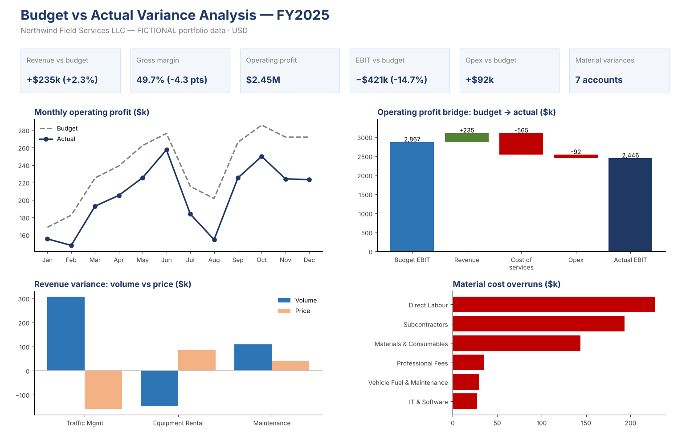

# Project 03: Budget vs Actual Variance Analysis (FY2025)

> **Portfolio project using fictional data.** Northwind Field Services LLC is an invented company. None of the figures come from any real employer or client, and they are not employment results.

## Business question
Revenue beat budget, so why did operating profit miss? Which variances matter, what caused them, and what should management do next?

## Dataset (fictional)
- 12 months of budget and actual figures for 16 P&L accounts across 4 departments
- Three revenue lines with units and prices, which allows a price vs volume analysis
- Cost of services, plus operating expenses for Operations, Sales & Marketing, Finance & Admin and IT

## What the workbook does
| Sheet | Purpose |
|---|---|
| **Assumptions** | Fiscal year and materiality thresholds ($25k **and** 5% of budget). Yellow cells are editable |
| **Data** | Monthly budget and actual by account, category and department |
| **Variance_Analysis** | Full-year P&L: budget, actual, variance $ and %, favourable/unfavourable flag, materiality flag, and commentary on each variance |
| **Monthly_PnL** | Monthly budget vs actual operating profit, with cumulative variance and a reconciliation check |
| **Price_Volume** | Revenue variance split into volume and price effects for each service line |
| **Dept_Variance** | Operating expense variance by department, with a reconciliation check |
| **Dashboard** | KPI tiles and charts |

Variance = Actual − Budget. A variance is **favourable** when revenue is above budget or costs are below budget. All figures come from formulas (`SUMIFS`, `IF/AND`, `COUNTIF`), so changing the data or the thresholds updates the whole analysis.

## Key results
| KPI | Budget | Actual | Variance |
|---|---|---|---|
| Revenue | $10.29M | $10.52M | **+$235k (+2.3%) F** |
| Gross margin | 54.0% | 49.7% | **−4.3 pts U** |
| Operating expenses | $2.69M | $2.78M | +$92k (+3.4%) U |
| Operating profit (EBIT) | $2.87M | $2.45M | **−$421k (−14.7%) U** |

## Insights
1. **Revenue grew but margin fell.** Revenue was $235k above budget, but cost of services overran by $565k, so gross margin dropped 4.3 points. The profit miss is a cost problem, not a sales problem.
2. **Price vs volume:** Traffic Management volumes were well above plan (+$307k), but discounting cost $159k. Equipment Rental showed the opposite pattern: fewer rental days (−$148k), partly offset by higher prices (+$85k). Discounting should be reviewed against the margin earned on each job.
3. **Cost overruns:** Direct Labour (+$228k, overtime and wage inflation), Subcontractors (+$193k, +27%) and Materials (+$144k, supplier price increases) account for most of the miss. The next step is a make-vs-buy review of peak-season subcontracting and renegotiation of consumables pricing.
4. **Opex:** Professional fees (+37%, Corporate Tax and audit advisory) and IT licences (+19%) were not in the budget. They should be built into the next budget rather than treated as one-off overruns.
5. **Every month missed budget**, so the cumulative operating profit variance widened steadily. The budget's cost assumptions, not timing, appear to be the main issue.

## Skills demonstrated
Budgeting and variance analysis · price/volume analysis · materiality assessment · variance commentary for management reporting · P&L bridge · Excel (`SUMIFS`, nested `IF`, `COUNTIF`, conditional formatting, charts)

## Files
- `Budget_vs_Actual_Variance_Analysis_Fictional_FY2025.xlsx`: the workbook
- `BvA_Dashboard_Preview.png`: dashboard preview

*Author: Muhammed Shabeeb MK · Finance & Accounting portfolio*
