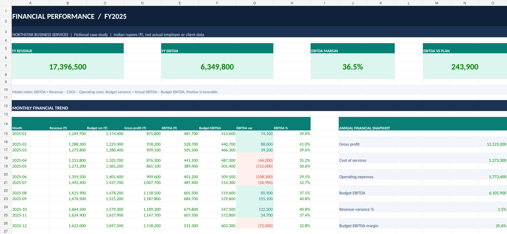

# Finance & Data Analytics Portfolio

**Muhammed Shabeeb MK**

Finance and operations professional with 5+ years of experience across India and the UAE in financial accounting, auditing, financial reporting, billing and commercial finance operations.

B.Com in Accounting & Finance | CMA (USA) – Both Examination Parts Passed

## Areas of Expertise
- Financial Reporting & Analysis
- Accounts Receivable and Payable
- Financial Reconciliation
- Management Reporting
- Excel and Power BI
- Finance Operations and Process Improvement

## Portfolio Projects

1. Financial Performance Dashboard – Excel and Power BI
2. Accounts Receivable & Cash Flow Analysis
3. Budget vs Actual Variance Analysis

Projects will use fictional or publicly available data for demonstration purposes.

## Professional Profile

[LinkedIn](https://www.linkedin.com/in/muhammed-shabeeb-mk-2473061aa/)

## Project 01 — Financial Performance Dashboard

A financial reporting and analysis project using fictional FY2025 business data.

### Key Analysis
- Revenue and expense analysis
- Gross profit and EBITDA
- Budget vs Actual variance analysis
- Monthly financial performance
- Executive KPI dashboard

### Dashboard Preview

### Project Files

[View Excel Dashboard](Financial_Performance_Dashboard_Fictional_FY2025.xlsx)

[View Project Documentation](PROJECT_01_Financial_Performance_README.md)

**Tools:** Microsoft Excel, Financial Reporting, Variance Analysis

**Data:** Fictional company data for portfolio demonstration.

